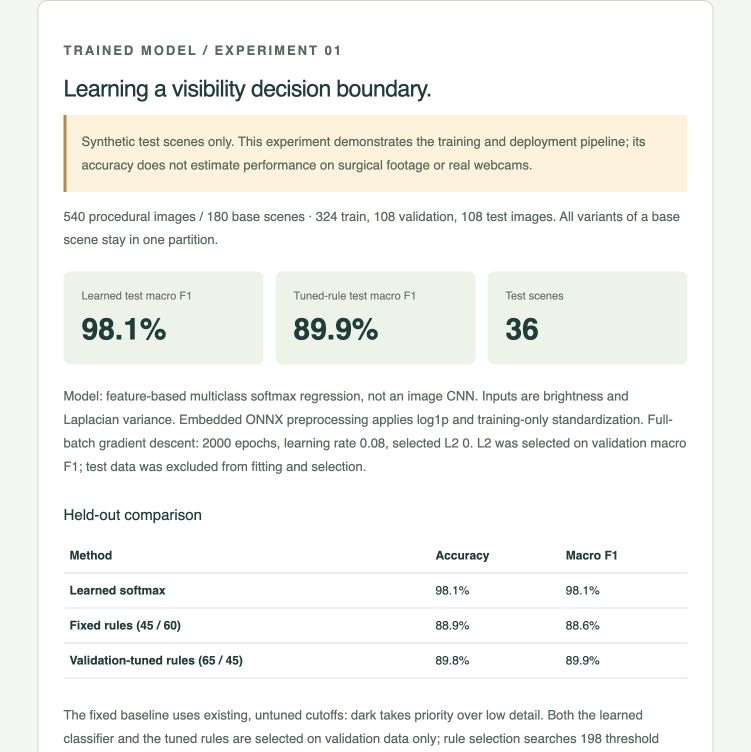

# Camera Quality Monitor

**Live video-quality measurements, a trained visibility classifier, and reproducible ONNX evaluation.**

This project samples a webcam or recorded video, measures brightness and spatial detail, and runs two local ONNX models: an interpretable threshold-based score and a learned three-class visibility classifier. The interface includes a live-video overlay, guided threshold controls, CSV export, and the measured training experiment.

The learned model is trained on **synthetic procedural images**, not surgical footage. This is a computer-vision engineering prototype relevant to investigating surgical-camera quality; it is not a surgical safety system, semantic obstruction detector, or clinically validated product. No affiliation with Andromeda Surgical is implied.

## See the demo



The screenshot shows an actual application report. Results apply only to held-out images from the procedural generator. The screenshot is not evidence of surgical or real-webcam accuracy.

### Run locally

Prerequisites: Node.js 20+ and Python 3.11+. No API keys, paid services, camera uploads, or GPU are required.

```sh
git clone https://github.com/S-hil/onnx_project.git
cd onnx_project
npm ci
npm start
```

Open **http://127.0.0.1:8765/**. `npm ci` installs the pinned JavaScript dependencies and copies ONNX Runtime assets into `dist/vendor`. Python serves the static application on localhost. The committed model artifacts are sufficient to run the demo; Python training dependencies are optional unless retraining or testing the models.

There is no hosted public demo configured by this repository. GitHub displays the source and this guide; it does not execute the application automatically.

### Demo A — without a camera or upload

1. Wait for **ONNX active · 2 models · WASM / CPU · startup parity passed**.
2. Select **Try synthetic demo**. This loads a 61-sample illustrative numeric timeline, separate from the generated training dataset. Both ONNX models run on those measurements.
3. Review the dark samples at **0:16–0:23** and low-detail samples at **0:38–0:46**. Amber points identify rule-based threshold violations.
4. Read the **Trained model** line. It shows the latest predicted class and the three softmax outputs. These are uncalibrated model outputs, not clinical confidence values.
5. Select **More warnings**, then **Fewer warnings**. The threshold-based score and warnings change; the learned classifier does not change because its parameters are fixed.
6. Select **Export CSV** to inspect source labels, measurement timestamps, threshold settings, learned classes, and probabilities.
7. Scroll to **Trained model / Experiment 01**, or open **http://127.0.0.1:8765/#experiment**, to inspect the held-out comparison, confusion matrix, error cases, and downloadable JSON artifacts.

Synthetic timeline timestamps cannot seek to video because that mode contains numeric values rather than recorded frames.

### Demo B — live webcam and overlay

1. Select **Start live camera** and allow camera access. Only video is requested; microphone access is disabled.
2. Show a detailed, well-lit scene. Inspect the full-frame brightness and detail measurements and the latest learned prediction.
3. Reduce the lighting and watch the brightness signal. Show an out-of-focus nearby object and watch how edge detail responds. Actual behavior depends on the scene, auto-exposure, focus, and camera processing.
4. The video overlay shows the rule-based score, warnings, sample timestamp, and learned class. **Amber means a rule cutoff was missed; green means both cutoffs were met.** Neither color establishes that the view is unobstructed.
5. Set the sampling interval to **Every 0.5 seconds** for faster visible updates. Analysis is sampled, not performed on every camera frame.
6. To set a reference, hold a scene you judge clear for at least five samples, then select **Use recent clear samples**. Verify the suggested cutoffs on separate clear and degraded scenes.
7. Select **Stop camera**, then export a stable report. Camera images are not recorded; the report contains numeric telemetry only.

Leaving or hiding the page stops camera acquisition. If the embedded browser denies camera access, open the localhost URL in Chrome or Safari. The project does not request camera access until the start button is selected.

### Demo C — recorded video

1. Select a browser-supported video using **Select video**.
2. Choose the sampling interval, then select **Analyze video**.
3. The app seeks to sample times, decodes frames, measures their image features, and runs both ONNX models.
4. Select a flagged timestamp to seek to that position in the recording. Events between samples may be missed.
5. Change thresholds to reclassify existing measurements without decoding again. Export all measurements to CSV.

Video codec support is determined by the browser. There is no backend transcoder.

## How to interpret the measurements

**Brightness** is a weighted RGB average on a 0–255 scale. Zero is black and 255 is white. Higher is brighter, not necessarily better: highlights and overexposure can hide relevant information.

**Detail** is the variance of a discrete Laplacian. It has no universal good/bad scale. Blur often reduces it, but clear smooth scenes can also have low detail. Noise, sharp edges, and compression artifacts can increase it.

**Threshold sliders** set minimum acceptable measurements. Raising a cutoff creates more warnings; lowering it tolerates darker or lower-detail images. They do not change camera exposure, lighting, or focus.

**Quality score** is a threshold-normalized heuristic. A score of 100 means both cutoffs are met. A score near 50 means the weaker measurement is around half its cutoff. The same image can receive a different score after changing thresholds. This is separate from the learned classifier.

**Learned class** is the largest softmax output among `clear`, `dark`, and `low_detail`. The model always chooses one of those labels, even for unfamiliar scenes. Its outputs are not calibrated probabilities of actual visibility or safety.

The guided presets are illustrative:

- Fewer warnings: brightness cutoff 25; detail cutoff 30.
- Default: brightness 45; detail 60.
- More warnings: brightness 70; detail 120.

Reference calibration takes the latest 5–10 measured samples, calculates each feature's median, and proposes 70% of that median as the cutoff. It clamps brightness to 5–150 and detail to 5–300. The user must establish that these samples represent a clear scene. Synthetic timeline values cannot calibrate a camera. This procedure is a convenience, not a validated calibration method.

## Processing architecture

```text
Webcam: getUserMedia(video only)      File: HTMLVideoElement seek/decode
                     \                /
                    Canvas 2D resize / readback
                    320 px wide, preserve aspect ratio
                               |
                      Float64 grayscale buffer
                               |
              mean brightness B + Laplacian variance D
                               |
                     float32 metrics tensor [N,2]
                               |
             +-----------------+------------------+
             |                                    |
   Rule-based ONNX graph                Trained ONNX classifier
   Div -> ReduceMin -> Clip -> Mul      Add -> Log -> Sub -> Div
   thresholds tensor [2]                -> MatMul -> Add -> Softmax
             |                                    |
       quality scores [N]                  probabilities [N,3]
             +-----------------+------------------+
                               |
              overlay / timeline / explanation / CSV
```

The UI is buildless HTML/CSS and JavaScript ES modules. `onnxruntime-web@1.20.1` runs both graphs using the WASM execution provider with one thread. All inference is local. The app makes no third-party network requests once its locally served dependencies are available.

### Feature extraction

For gamma-encoded RGB pixel values:

```text
Y′(x,y) = 0.2126 R′(x,y) + 0.7152 G′(x,y) + 0.0722 B′(x,y)
B = mean(Y′)

L(x,y) = Y′(x−1,y) + Y′(x+1,y)
       + Y′(x,y−1) + Y′(x,y+1) − 4Y′(x,y)
D = mean(L²) − mean(L)²
```

The weighted RGB value is a luma-like proxy, not calibrated physical luminance. The Laplacian uses interior pixels only; image boundaries are excluded. The feature pass is O(W×H) with a Float64 grayscale buffer. Fixed analysis width reduces one source of scale variation, but aspect ratio, scene content, and camera processing still affect results.

### Model 1 — deterministic baseline

Artifact: `dist/models/visibility-baseline.onnx` (518 bytes).

Inputs: `metrics`, float32 `[N,2]`, ordered `[B,D]`; and `thresholds`, float32 `[2]`, ordered `[Tb,Td]`. Thresholds must be positive.

Output: `scores`, float32 `[N]`.

```text
score = 100 × clip(min(B/Tb, D/Td), 0, 1)
dark flag       = B < Tb
low-detail flag = D < Td
```

JavaScript rounds the score for presentation and derives flags from the original measurements. Float32 ONNX arithmetic may differ slightly from Float64 reference calculations near rounding boundaries. The graph has no learned parameters.

### Model 2 — learned softmax classifier

Artifact: `dist/reports/visibility-trained.onnx`.

Input: `metrics`, float32 `[N,2]`, ordered `[B,D]`.

Output: `probabilities`, float32 `[N,3]`, ordered `[clear,dark,low_detail]`.

```text
u = log(1 + metrics)
z = (u − training_mean) / training_std
logits = z @ W + b
probabilities = softmax(logits)
```

This is **multiclass logistic regression**, not a CNN or pretrained vision backbone. It learns six weights (`W` has shape `[2,3]`) and three biases. Log transformation, training-set means, and standard deviations are embedded in the exported graph so Python and browser inference use the same preprocessing.

The trained classifier uses the same two features as the baseline. It cannot recover information discarded by those features and does not locate affected regions in the video.

### Startup and error handling

Initialization loads both graphs. The baseline must return 50 for metrics `[90,30]` with thresholds `[45,60]`. The learned graph is checked against eight stored reference vectors with a maximum permitted absolute probability difference of `1e-5`.

The camera, file input, and synthetic demo remain disabled until initialization succeeds. Missing assets or failed parity checks produce an error instead of silently substituting JavaScript inference. Camera permission denial, absent hardware, decode timeouts, and device-in-use conditions have recovery messages.

## Training experiment

The training script is `scripts/train_visibility.py`; it uses NumPy for generation, preprocessing, optimization, and the reference implementation. ONNX helpers export the fitted parameters, and Python ONNX Runtime evaluates the exported artifact.

### Dataset generation and split integrity

The experiment generates **180 base grayscale scenes** at 320×180 pixels. Scenes combine sinusoidal patterns, rectangular intensity changes, varied brightness, and low-amplitude noise.

Each base scene produces three images:

- Clear: the undegraded procedural image.
- Dark: intensity multiplied by a sampled factor between 0.12 and 0.48.
- Low detail: Gaussian smoothing in the frequency domain, with sigma between 1.5 and 5 pixels.

Labels are assigned by the applied transformation. They are not independent human assessments. Frequency-domain smoothing introduces periodic boundary assumptions; procedural textures and transformation artifacts differ from real cameras.

Scene IDs are shuffled using seed `20261026` and partitioned **before variants are generated**:

- Training: 108 scene groups, 324 images.
- Validation: 36 scene groups, 108 images.
- Test: 36 scene groups, 108 images.

All related variants of a base scene remain in the same partition. Means and standard deviations are fitted using training features only. The committed dataset manifest records scene ID, split, transformation label, brightness, and detail. Images are generated in memory and can be reproduced from their scene seeds.

### Optimization and selection

The classifier uses full-batch gradient descent for 2,000 epochs with learning rate 0.08 and zero-initialized weights and biases. Cross-entropy gradients update the weights and biases; L2 regularization is applied to weights only. Candidates `0`, `0.01`, and `0.1` are compared using validation macro F1. The selected L2 value is `0` for the committed experiment. Training loss snapshots are included in the report.

A second comparator tunes the rule-based method over 198 brightness/detail cutoff pairs using validation macro F1. Selected cutoffs are brightness `65` and detail `45`. For multiclass rule comparisons, dark takes priority, then low detail, then clear. The ordinary UI still supports simultaneous heuristic flags.

The held-out test partition is excluded from feature fitting and hyperparameter selection. No extra fitting on the combined train/validation set occurs after selection.

## Measured evaluation

These are **synthetic held-out results**, not estimates for surgical footage or real webcams:

- Learned classifier: accuracy **98.1%**; macro F1 **98.1%**.
- Validation-tuned rules: accuracy **89.8%**; macro F1 **89.9%**.
- Original fixed rules (45 / 60): accuracy **88.9%**; macro F1 **88.6%**.

Macro F1 is the unweighted mean of per-class F1 scores. Each test class has 36 images. Precision measures how often a predicted class is correct; recall measures how much of that true class is recovered. The report includes all three quantities per class.

The learned model's confusion matrix, with true classes as rows and predictions ordered `[clear,dark,low_detail]`, is:

```text
clear       36   0   0
dark         1  35   0
low_detail   0   1  35
```

Two learned error cases are retained:

- Scene 4, darkened variant: predicted clear; brightness 82.2 and detail 45.5.
- Scene 150, blurred variant: predicted dark; brightness 59.9 and detail 8.4.

These illustrate ambiguity in transformation-based labels and two-feature classification. The learned model outperforms both tested rule configurations in this small generator-specific experiment; that does not demonstrate real-world or clinical superiority. Related variants share scene content, so 108 test images do not represent 108 independent scene groups.

### Export parity and timing

On the held-out inputs, maximum absolute probability difference between the NumPy implementation and Python ONNX Runtime is approximately **8.21 × 10⁻⁷**. Tests require parity within `1e-5`.

The committed report also contains a Python CPU microbenchmark: 20 warmups followed by 200 batch-size-one inference calls. It records p50/p95 and the host platform. These measurements exclude image generation, acquisition, feature extraction, browser rendering, and browser WASM execution. Timing changes with the machine and run; see the JSON artifact for the actual recorded values.

In the application, metric compute time measures canvas resize/readback and feature extraction. The ONNX runtime bar measures execution and output handling for both graphs over the retained batch. Neither is end-to-end video latency. Updating the whole retained history makes inference cost dependent on sample count.

### Auditable artifacts

- `dist/reports/evaluation.json`: split sizes, selected parameters, training loss history, accuracy, per-class precision/recall/F1, confusion matrices, error cases, parity, timing, and hashes.
- `dist/reports/dataset-manifest.json`: generated sample provenance and partition assignments.
- `dist/reports/learned-reference.json`: learned weights, normalization parameters, and startup parity probes.
- `MODEL_CARD.md`: intended use, training provenance, deployment contract, and limitations.

The browser evaluation report renders these committed artifacts rather than inventing metrics at runtime.

## Reproduce training and verification

Install the optional pinned Python dependencies in an isolated environment:

```sh
python3 -m venv .venv
.venv/bin/pip install -r requirements-dev.txt
```

Regenerate the deterministic graph, retrain the classifier, and write measured artifacts:

```sh
.venv/bin/python scripts/export_model.py
.venv/bin/python scripts/train_visibility.py
```

Run JavaScript and Python checks:

```sh
npm test
.venv/bin/python tests/model_parity.py
.venv/bin/python -m unittest discover -s tests -p 'test_*.py'
```

The checks currently comprise 10 JavaScript tests, 5 Python unit tests, and 3,000 deterministic-score parity comparisons. They cover feature behavior, threshold guidance, mocked camera lifecycle, permission cancellation, overlay state, scene split integrity, training-only standardization, learned ONNX parity, confusion-matrix calculation, and reproducible generation.

Camera tests use mocked browser APIs; they do not prove compatibility with every physical webcam. Browser initialization separately checks the actual WASM implementation. GitHub Actions installs dependencies, runs the checks, verifies deterministic-baseline export, and performs a fresh training run in a temporary directory. Timing artifacts are not expected to be byte-identical across hosts.

On Windows, use `.venv\Scripts\python` and `.venv\Scripts\pip` instead of `.venv/bin/...`.

## Sampling, resource lifecycle, and privacy

Live sampling targets 0.5, 1, 2, or 5 seconds. The next timeout is scheduled after feature extraction and scheduling the asynchronous report update; actual spacing can exceed the target. Live sample timestamps use `performance.now()`. Camera dimensions are requested at an ideal 1280×720; actual dimensions depend on the device. File sample positions are seek timestamps, not guaranteed frame indices.

The overlay summarizes the most recent analyzed full frame. It is not a segmentation mask or detection box. It updates at the sampling cadence, is excluded from measured pixels, and is not recorded into a video.

Stop camera, hide the page, or navigate away to release all acquired tracks. A cancelled pending permission result cannot reopen capture: any arriving stream is stopped. Live capture stops at 3,600 samples; file analysis caps work at 20,000 samples. The page renders up to 200 flagged samples, while export retains all samples.

No audio is requested. No camera frames are recorded, uploaded, or sent to an inference service. Processing and numeric history remain in browser memory until navigation or reload; exported reports remain wherever the user saves them.

## CSV contract

Each row contains:

```text
source, time_seconds, brightness, laplacian_variance, quality_score,
brightness_threshold, detail_threshold, compute_ms, flags,
learned_class, p_clear, p_dark, p_low_detail
```

`source` distinguishes `camera`, `video`, and `synthetic`. Flags can contain multiple rule violations separated by semicolons. Threshold columns record the current report settings; changing controls reclassifies the retained history. Learned probabilities are independent of those controls. `compute_ms` is empty for the illustrative numeric demo. Live timestamps are relative to session start; file timestamps refer to video positions.

## Repository layout

```text
dist/
  index.html, style.css     Interface, technical notes, overlay and controls
  app.js                   Acquisition, sampling, lifecycle, report and export
  metrics.mjs              Feature extraction and reference score
  guidance.mjs             Clear-scene threshold suggestions
  inference.mjs            Both ONNX sessions and startup parity checks
  evaluation.mjs           Measured experiment report rendering
  models/                  Deterministic baseline ONNX graph
  reports/                 Learned graph, evaluation and provenance artifacts
  vendor/                  Generated runtime assets; ignored by Git
scripts/
  export_model.py          Build and check the deterministic graph
  train_visibility.py      Generate, split, train, export and evaluate
  prepare-runtime.mjs      Copy pinned runtime files after npm installation
tests/                     JavaScript, NumPy and ONNX checks
docs/evaluation.png        Actual app screenshot using synthetic results
MODEL_CARD.md              Intended use and model limitations
.github/workflows/tests.yml Automated verification and retraining
```

## Limitations and next experiment

Both methods share a two-feature bottleneck. A sharp obstruction can look detailed; smooth clear scenes can look blurred; noise can increase detail; highlights can hide local darkness. Auto-exposure, compression, changing aspect ratio, motion, and mixed degradations alter the signals. No spatial localization, temporal smoothing, unknown-class detector, or calibrated uncertainty is implemented.

The synthetic generator includes no tissue, fluid, smoke, instruments, endoscopic illumination, or actual clinical recordings. The next study should use licensed target-domain footage and independent visibility annotation, split by recording/session/device, compare against tuned baselines, and measure event-level false alarms and detection delay. No robotic control or clinical decision support is implemented.

## Troubleshooting and deployment

- **Camera unavailable:** use localhost or HTTPS in a supported browser; check browser/OS permission and whether another application holds the device. The embedded browser may not allow acquisition.
- **ONNX asset error:** run `npm ci` again, then refresh. Do not open `index.html` directly as a `file://` URL; the app fetches local model and reference files through HTTP.
- **Port 8765 occupied:** stop the prior preview or serve `dist` on another local port with Python's HTTP server.
- **Too many samples:** increase the interval or use a shorter clip. Frame sampling may miss brief events.
- **Unexpected model result:** inspect the raw measurements and consider domain shift. Adjusting heuristic sliders does not retrain the classifier.

GitHub Pages would require a workflow that runs `npm ci` and publishes `dist`, including generated runtime assets. A hosted camera demo requires HTTPS. Keep private recordings and exported CSVs out of version control; `.gitignore` excludes these and generated dependencies. A project license has not yet been selected; dependencies retain their own licenses.

## References

- [ONNX Runtime Web documentation](https://onnxruntime.ai/docs/tutorials/web/)
- [ONNX Softmax operator](https://onnx.ai/onnx/operators/onnx__Softmax.html)
- [ONNX Runtime Python API](https://onnxruntime.ai/docs/api/python/api_summary.html)
- [Camera acquisition: getUserMedia](https://developer.mozilla.org/en-US/docs/Web/API/MediaDevices/getUserMedia)
- [Media track lifecycle: stop](https://developer.mozilla.org/en-US/docs/Web/API/MediaStreamTrack/stop)
